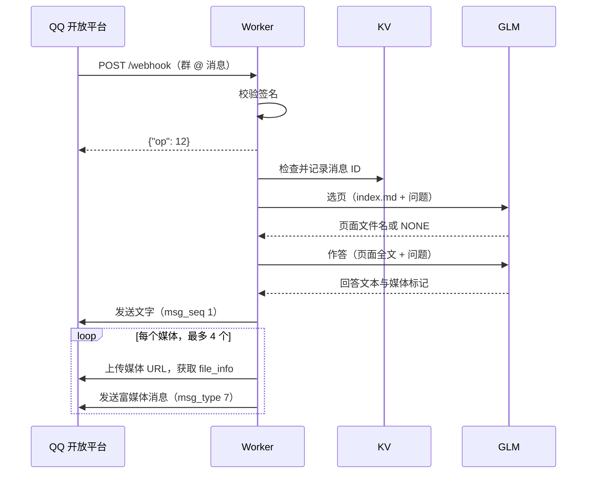

# QQ 群 Wiki 问答（qa-bot）
> 模块职责：接收 QQ 群 @机器人消息，只依据 wiki/ 内容生成回答并回复文字、图片与视频
> 负责人：Claude Opus 5.5
> 系统模块：backend
> 关联存储：Workers KV `DEDUP_KV`（消息去重）
> 关联服务：QQ 开放平台 API v2、智谱 GLM（OpenAI 兼容接口）

## 回调接收
### 功能描述
QQ 开放平台把事件推送到 `POST /webhook`。Worker 先用 Ed25519 校验签名，签名不通过返回 401。
- op 13（回调地址验证）：用 AppSecret 派生的私钥对 `event_ts + plain_token` 签名后返回。
- op 0 且事件为 `GROUP_AT_MESSAGE_CREATE`：立即返回 ACK（op 12），用 `ctx.waitUntil` 异步回答。
- 其他事件：返回 ACK，不处理。

签名私钥派生：AppSecret 循环重复到不少于 32 字节，取前 32 字节作为 Ed25519 种子。签名原文为 `X-Signature-Timestamp` 请求头 + 原始请求体，签名放在 `X-Signature-Ed25519` 请求头（hex）。

### 接口信息
| 项     | 值                     |
| ------ | ---------------------- |
| method | POST                   |
| path   | /webhook               |
| 权限   | Ed25519 签名校验       |

### 入参要求
| 参数名 | 类型   | 必填 | 校验规则        | 说明                  |
| ------ | ------ | ---- | --------------- | --------------------- |
| op     | number | 是   | 0 或 13         | 操作码                |
| id     | string | 否   | -               | 事件 ID               |
| t      | string | 否   | -               | 事件类型              |
| d      | object | 是   | -               | 事件内容              |

群 @ 消息示例：
```json
{
  "op": 0,
  "id": "GROUP_AT_MESSAGE_CREATE:abc",
  "t": "GROUP_AT_MESSAGE_CREATE",
  "d": {
    "id": "ROBOT1.0_xxx",
    "content": " 怎么加入群",
    "group_openid": "C9F778FE6ADF9D1D1DBE395BF744A33A",
    "author": {
      "member_openid": "E4F4AEA33253A2797FB897C50B81D7ED"
    }
  }
}
```

### 返回
| 场景     | HTTP 状态 | 响应体                                            |
| -------- | --------- | ------------------------------------------------- |
| 地址验证 | 200       | `{"plain_token": "...", "signature": "<hex>"}`    |
| 事件     | 200       | `{"op": 12}`                                      |
| 签名错误 | 401       | 空                                                |
| 其他路径 | 404       | 空（静态媒体文件除外）                            |

## Wiki 问答
### 功能描述
Wiki 按 Karpathy LLM Wiki 结构组织：`wiki/raw/` 放源资料，`wiki/pages/` 放页面，`wiki/pages/index.md` 列出全部页面与一行摘要，`wiki/media/` 放图片和视频。部署前由 `scripts/build-wiki.ts` 把页面生成为 `src/wiki/generated-pages.ts` 打包进 Worker，媒体文件作为 Workers 静态资源发布在 `/media/<文件名>`。

回答分两次调用模型：
1. 选页：只给模型 `index.md` 和问题，要求输出相关页面文件名，无相关页面输出 `NONE`。代码只接受 index 中真实存在的页面，最多 3 页。
2. 作答：给模型选中页面全文和问题，要求只依据资料回答，可以整理改写，不得补充资料外的事实；资料无法回答时输出 `NONE`；需要配图时在末尾输出 `[[media:文件名]]`。代码只接受选中页面里真实引用过的媒体文件。

业务规则：
- 选页或作答结果为 `NONE` 时回复固定拒答文案，不调用联网搜索（智谱联网搜索按次收费，已排除）。
- 问题为空时回复使用说明。
- 回答为纯文本，代码去掉 Markdown 图片语法。
- 每条用户消息最多 5 次被动回复：第 1 条发文字，之后每个媒体一条，最多 4 个媒体。
- 媒体上传失败只记录日志并跳过该媒体，不影响文字回答。
- 同一 `d.id` 在 1 小时内只处理一次（KV 记录，TTL 3600 秒）。

### 业务流程


### 外部接口
| 用途            | 接口                                                     |
| --------------- | -------------------------------------------------------- |
| 获取 token      | `POST https://bots.qq.com/app/getAppAccessToken`         |
| 发送群消息      | `POST https://api.sgroup.qq.com/v2/groups/{group_openid}/messages` |
| 上传群富媒体    | `POST https://api.sgroup.qq.com/v2/groups/{group_openid}/files`    |
| 模型对话        | `POST {LLM_BASE_URL}/chat/completions`                   |

富媒体 `file_type`：1 图片（png/jpg），2 视频（mp4）。

### 配置
| 变量          | 类型   | 说明                                   |
| ------------- | ------ | -------------------------------------- |
| QQ_APP_ID     | var    | 机器人 AppID                           |
| QQ_APP_SECRET | secret | 机器人 AppSecret                       |
| LLM_BASE_URL  | var    | 模型接口地址                           |
| LLM_MODEL     | var    | 模型名                                 |
| LLM_API_KEY   | secret | 模型密钥                               |
| DEDUP_KV      | KV     | 消息去重                               |

### 异常处理
| 场景                 | 处理                                 | 用户看到的回复               |
| -------------------- | ------------------------------------ | ---------------------------- |
| 签名错误             | 返回 401                             | -                            |
| 配置缺失             | 记录错误日志，返回 500               | -                            |
| 模型调用失败         | 记录错误日志                         | 暂时无法回答，请稍后再试。   |
| 范围外问题           | -                                    | 这个问题不在知识库范围内。   |
| 媒体上传或发送失败   | 记录警告日志，跳过该媒体             | 只收到文字                   |
| QQ 发送文字失败      | 记录错误日志                         | -                            |

### 未确认事项
- 文字与媒体能否放在同一条消息、富媒体是否计入 5 次被动回复、图片视频大小上限、QQ 能否拉取 workers.dev 域名文件：官方文档未读到，需在群内实测。
- 日志：Workers 只能通过 console 输出到 Workers Logs，`src/logger.ts` 统一输出 JSON 结构化日志，业务代码不直接调用 console。
