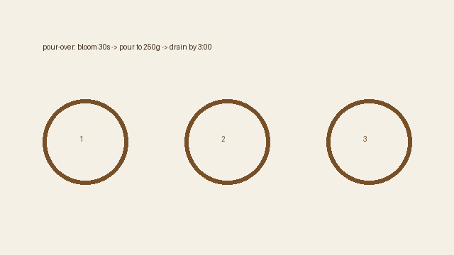

# 手冲咖啡基础
## 参数
- 粉水比：1:15，例如 15 克咖啡粉配 225 到 250 克水。
- 水温：90 到 93 度。浅烘豆用偏高温度，深烘豆用偏低温度。
- 研磨度：接近白砂糖颗粒大小。

## 步骤
1. 闷蒸：先注入 30 克水，等待 30 秒。
2. 注水：分 2 到 3 次注水，总水量到 250 克。
3. 滴滤：整个过程在 3 分钟内完成。

[注水演示视频](../media/pour-over-demo.mp4)

口味不对时见 [口味问题排查](taste-troubleshooting.md)，器具见 [器具清单](equipment.md)。
